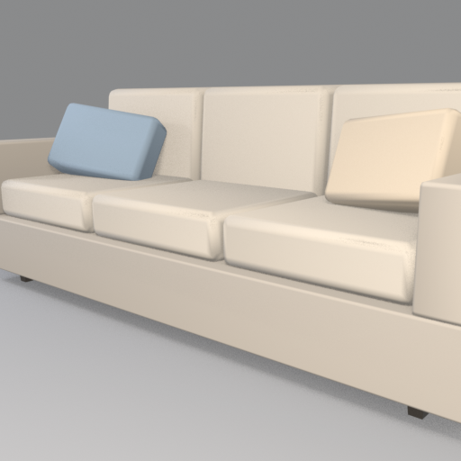
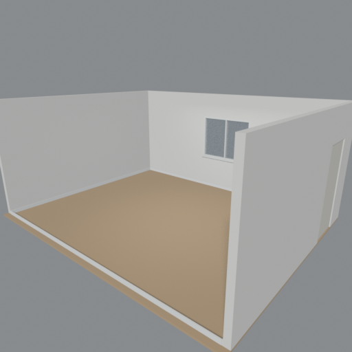
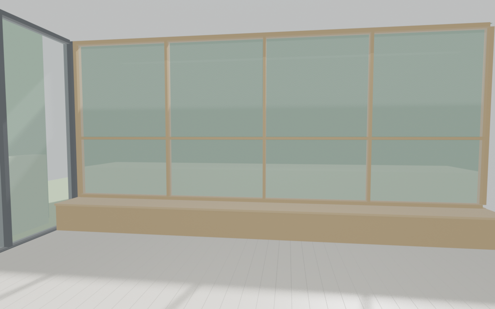
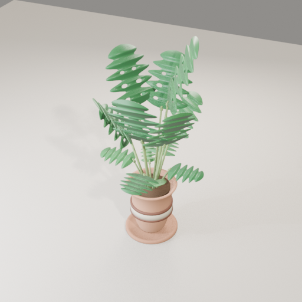

# Project notes, 8 Nov 2026

Room designer for a one-day hackathon. Catalog furniture and room shells share one coordinate system, so a piece dropped into a room sits on the floor and faces the right way. The meshes are simple Blender models, one folder per object, built in parallel and checked into this repo. A single JSON document under `db/` is what the frontend loads.

The procedures that worked are written up as Cursor agent skills:

- [Build one furniture model](.cursor/skills/blender-furniture-model/SKILL.md)
- [Build one room from reference photos](.cursor/skills/blender-room-model/SKILL.md)
- [Fan out one agent per object](.cursor/skills/parallel-model-agents/SKILL.md)
- [Rebuild the fake frontend database](.cursor/skills/fake-db-for-frontend/SKILL.md)









## Goal

Give the web app a living-room catalog it can place in a room:

- 17 furniture meshes, F001–F017, taken from the spreadsheet catalog
- One generic living room, plus a catalog index and this repo's README
- A fake JSON database the frontend can fetch, with storefront fields filled in
- Five more rooms modeled from reference photos, empty shells with anchors for the furniture

Each mesh is rebuilt from a headless Blender script. Nothing is downloaded at runtime except Blender itself, which is not committed.

## Timeline

Times are UTC on 8 Nov 2026. Each agent was asked to finish in about 15 minutes. The overlap is what made the wall clock short.

| Phase | When | What landed |
| --- | --- | --- |
| Start | 17:36 | Initial commit |
| Furniture | 17:41–18:04 | F001–F017, one agent and one folder each. Pull requests #1–#4 and #6–#18 |
| Generic room and catalog | 17:46–17:52 | `rooms/living_room_generic/`, `catalog/furniture.json`, root README. Pull request #5, overlapping the furniture wave |
| Fake database | 18:08–18:36 | `db/db.json` in pull request #19, then brands, colors, images, sponsored rows, and facets in #20. The file's `generated_at` is 18:34:52Z |
| Photo rooms | 18:36–18:51 | Five shells, pull requests #21–#25 |
| Room data in the database | after 18:51 | Pull request #26 was still open. It edits only `db/` |

## Layout

```text
catalog/furniture.json          web index: id, price, inches, meters, folder
db/db.json                      document the frontend fetches
db/build_db.py                  rebuilds db.json
db/source/objects.xlsx          Furniture Catalog sheet
db/source/enrichment.json       fictional brands, copy, stock, sponsored ranks
models/<category>/<id>_<slug>/  one furniture item
rooms/<slug>/                   one room shell
```

Every model folder holds the same six files:

| File | Role |
| --- | --- |
| `build.py` | Headless Blender script. bpy, bmesh, and mathutils only |
| `model.glb` | glTF binary for the viewer |
| `model.blend` | Source scene |
| `preview.png` | 512×512 for furniture, about 1024×640 for the photo rooms |
| `metadata.json` | Catalog fields plus the measured bbox |
| `README.md` | What it is, and how to rebuild it |

Categories are lowercase. The folder slug is the lowercase item id, an underscore, and the name with punctuation collapsed to underscores. Example: `models/couch/f001_cloudline_3_seat_couch`.

## Furniture

Dimensions are the catalog size. Every mesh matched that box within the 2% tolerance. Triangle counts are measured from the exported glb. Prices are US dollars from `catalog/furniture.json`. All 17 are living-room pieces.

| ID | Item | Pull request | W × D × H | Triangles |
| --- | --- | --- | --- | --- |
| F001 | Cloudline 3-Seat Couch | [#7](https://github.com/wlamason/lovable-hackathon-2026/pull/7) | 84 × 36 × 33 in (2.1336 × 0.9144 × 0.8382 m) | 1,984 |
| F002 | Harbor 2-Seat Loveseat | [#9](https://github.com/wlamason/lovable-hackathon-2026/pull/9) | 60 × 35 × 34 in (1.524 × 0.889 × 0.8636 m) | 1,028 |
| F003 | Corner Modular Sectional | [#12](https://github.com/wlamason/lovable-hackathon-2026/pull/12) | 104 × 72 × 34 in (2.6416 × 1.8288 × 0.8636 m) | 1,196 |
| F004 | Reading Arc Floor Lamp | [#11](https://github.com/wlamason/lovable-hackathon-2026/pull/11) | 18 × 18 × 66 in (0.4572 × 0.4572 × 1.6764 m) | 3,600 |
| F005 | Soft Glow Table Lamp | [#2](https://github.com/wlamason/lovable-hackathon-2026/pull/2) | 10 × 10 × 20 in (0.254 × 0.254 × 0.508 m) | 6,576 |
| F006 | Tripod Corner Lamp | [#10](https://github.com/wlamason/lovable-hackathon-2026/pull/10) | 20 × 20 × 60 in (0.508 × 0.508 × 1.524 m) | 4,740 |
| F007 | Oakline Round Coffee Table | [#6](https://github.com/wlamason/lovable-hackathon-2026/pull/6) | 36 × 36 × 16 in (0.9144 × 0.9144 × 0.4064 m) | 2,576 |
| F008 | Slate Nesting Tables | [#8](https://github.com/wlamason/lovable-hackathon-2026/pull/8) | 32 × 32 × 18 in (0.8128 × 0.8128 × 0.4572 m) | 2,232 |
| F009 | Slim Side Table | [#14](https://github.com/wlamason/lovable-hackathon-2026/pull/14) | 18 × 18 × 22 in (0.4572 × 0.4572 × 0.5588 m) | 272 |
| F010 | Geometric Area Carpet 8x10 | [#4](https://github.com/wlamason/lovable-hackathon-2026/pull/4) | 96 × 120 × 0.5 in (2.4384 × 3.048 × 0.0127 m) | 24,334 |
| F011 | Soft Neutral Carpet 5x7 | [#1](https://github.com/wlamason/lovable-hackathon-2026/pull/1) | 60 × 84 × 0.5 in (1.524 × 2.1336 × 0.0127 m) | 308 |
| F012 | 48-Inch Smart TV | [#3](https://github.com/wlamason/lovable-hackathon-2026/pull/3) | 43 × 3 × 26 in (1.0922 × 0.0762 × 0.6604 m) | 500 |
| F013 | 65-Inch Smart TV | [#15](https://github.com/wlamason/lovable-hackathon-2026/pull/15) | 57 × 3 × 34 in (1.4478 × 0.0762 × 0.8636 m) | 340 |
| F014 | Tall Fiddle Leaf Plant | [#13](https://github.com/wlamason/lovable-hackathon-2026/pull/13) | 20 × 20 × 60 in (0.508 × 0.508 × 1.524 m) | 8,144 |
| F015 | Snake Plant | [#16](https://github.com/wlamason/lovable-hackathon-2026/pull/16) | 12 × 12 × 32 in (0.3048 × 0.3048 × 0.8128 m) | 9,656 |
| F016 | Monstera Floor Plant | [#18](https://github.com/wlamason/lovable-hackathon-2026/pull/18) | 24 × 24 × 48 in (0.6096 × 0.6096 × 1.2192 m) | 14,436 |
| F017 | Olive Tree in Pot | [#17](https://github.com/wlamason/lovable-hackathon-2026/pull/17) | 22 × 22 × 54 in (0.5588 × 0.5588 × 1.3716 m) | 28,740 |

The item id is not the pull request number. F011 is #1 and F001 is #7, because the agents finished in a different order and #5 was the room.

Styles: Modern (6), Minimal (3), Scandinavian (2), Japandi (2), Bohemian (2), Coastal (1), Industrial (1). Prices run from $39 (snake plant) to $1,299 (sectional).

## Rooms

Interior size is width (X) × depth (Y) × ceiling (Z), with the floor center at the origin. Triangle counts are the exported meshes. The mesh bbox is a bit larger than the interior because the walls sit outside the footprint and the floor has thickness.

| Room | Pull request | Interior | Triangles |
| --- | --- | --- | --- |
| [living_room_generic](rooms/living_room_generic) | [#5](https://github.com/wlamason/lovable-hackathon-2026/pull/5) | 4.88 × 6.10 × 2.74 m (16 × 20 × 9 ft) | 372 |
| [condo_open_kitchen](rooms/condo_open_kitchen) | [#21](https://github.com/wlamason/lovable-hackathon-2026/pull/21) | 6.71 × 5.49 × 2.74 m (22 × 18 × 9 ft) | 4,664 |
| [glass_garden_room](rooms/glass_garden_room) | [#22](https://github.com/wlamason/lovable-hackathon-2026/pull/22) | 6.10 × 4.88 × 2.90 m (20 × 16 × 9.5 ft) | 1,272 |
| [bright_loft](rooms/bright_loft) | [#23](https://github.com/wlamason/lovable-hackathon-2026/pull/23) | 5.7912 × 7.62 × 3.2004 m (19 × 25 × 10.5 ft) | 1,392 |
| [beamed_fireplace_living](rooms/beamed_fireplace_living) | [#24](https://github.com/wlamason/lovable-hackathon-2026/pull/24) | 5.4864 × 6.4008 × 2.5908 m (18 × 21 × 8.5 ft) | 1,472 |
| [studio_pass_through](rooms/studio_pass_through) | [#25](https://github.com/wlamason/lovable-hackathon-2026/pull/25) | 3.6576 × 7.4676 × 2.5908 m (12 × 24.5 × 8.5 ft) | 2,420 |

Pull request #5 also added `catalog/furniture.json` and the root README. The studio's open living floor is 18.5 ft of the 24.5 ft depth. The rest is the pass-through kitchen and the entry hall. The glass room's mesh bbox is 12.84 × 11.12 × 3.56 m because a garden plane sits outside the glass. Its interior is the row above.

Each photo room has `Sofa_spot`, `TV_wall`, `Rug_center`, `Coffee_spot`, and a few more empties. Yaw is degrees about Z applied to a furniture model whose front is local -Y. `free_floor` is the polygon or rect that excludes counters, the hearth, and the hall.

## Database

`db/db.json` is schema version 2, `demo_data: true`, generated 18:34:52Z. It joins the spreadsheet, the catalog, each model's measured bbox, and Principled colors parsed out of `build.py`.

- 17 items, 6 categories, 7 styles, 7 brands, 17 color swatches
- The only room in that file is `living_room_generic`. The photo rooms merged after the file was generated
- F001 is sponsored at rank 1, F004 at rank 2. Brands, SKUs, stock, and ship times are fictional and live in `db/source/enrichment.json`
- Card images are each item's `preview.png` on `raw.githubusercontent.com`. Lifestyle images are Unsplash photos shared across several items, so cards should use `images.card`
- Swatch hex values are display sRGB. Colors passed through `srgb_to_linear` keep the authored sRGB (Oakline `#D4AD7D`). Colors written straight into the shader socket are treated as linear (Cloudline fabric `#BFB5A8`). The snake plant swatch is the vertex-color mid green `#427752`

Rebuild with `python3 db/build_db.py`. Details, including the xlsx parser and the URL checks, are in the [database skill](.cursor/skills/fake-db-for-frontend/SKILL.md).

## Conventions

- Meters. One Blender unit is one meter. Inches convert by × 0.0254.
- Z up. Width along X, depth along Y, height along Z. The front of a furniture model faces -Y.
- Furniture origin is the bottom center of the footprint, on the floor at Z=0.
- Room origin is the interior floor center. Floor top is Z=0. Walls stand just outside that footprint, about 0.12 m thick.
- Materials are Principled BSDF colors. No image textures.
- glTF is exported Y-up for the web. The Blender scenes stay Z-up.
- Furniture bounding boxes match the catalog within 2%. Furniture stays under 30,000 triangles. Rooms stay under 50,000.

## Regenerate

Blender 4.2.3 LTS is not in the repo. Install `libxi6 libxxf86vm1 libxfixes3 libxrender1 libgl1 libegl1 libxkbcommon0 libsm6`, then unpack `blender-4.2.3-linux-x64.tar.xz` from the Blender 4.2 release directory into `/tmp`.

One furniture item or one room:

```bash
blender -b --factory-startup --python models/couch/f001_cloudline_3_seat_couch/build.py -- --outdir models/couch/f001_cloudline_3_seat_couch
blender -b --factory-startup --python rooms/living_room_generic/build.py -- --outdir rooms/living_room_generic
```

Check a folder, or every exported glb:

```bash
python3 .cursor/skills/blender-furniture-model/validate_model.py models/couch/f001_cloudline_3_seat_couch
python3 .cursor/skills/blender-furniture-model/validate_model.py --all
```

`--all` reported 23 passed and 0 failed on the tree after pull request #25. Warnings on older folders call out missing `triangle_count` values, READMEs that do not embed the preview, and room anchors that omit `rotation_z_deg`.

The database, from the repo root:

```bash
python3 db/build_db.py
```

Success is the line `validation ok` and exit code 0.

## Known limitations

- Meshes are proportion studies, not manufactured CAD. No image textures, no measured drawings.
- Several furniture READMEs name `preview.png` in a sentence and do not embed the image. The photo-room READMEs do embed it.
- F006, F007, and F009 do not record `triangle_count` in `metadata.json`. The glb counts are in the table above.
- `living_room_generic` leaves yaw off `TV_wall`, `Rug_center`, and `Coffee_spot`. Only `Sofa_spot` has `rotation_z_deg` 180. Its preview is 512×512 and its README does not embed the image. It also has no `free_floor`.
- `studio_pass_through` stores `yaw_deg` and not `rotation_z_deg`. The database builder only copies `rotation_z_deg`.
- `db.json` on main lists one room. The five photo rooms are in `rooms/` and not yet in that document.
- Lifestyle photos are shared, and the sheet does not name photographers. `photo.credit` is Unsplash.
- There is no root `.gitignore`. Blender writes `model.blend1` on a later save. Those backups had to be deleted by hand on F012, F013, and the living room.
- Some `.blend` files include the preview camera and floor, because the scene is saved after the still is set up. The glb is the product only.
- A bare `curl` against `download.blender.org` can get a Cloudflare challenge page instead of the Blender tarball.

## Next

- Let pull request #26 land the photo rooms into the database, instead of starting a second `db/` change.
- Backfill `triangle_count` on F006, F007, and F009, and `rotation_z_deg` on the studio anchors, then rebuild `db.json`.
- Point the frontend at `images.card`, place `model.glb` on an anchor with that anchor's yaw, and keep shared Unsplash photos off the product cards.
- Add a root ignore rule for `*.blend1` now that the parallel wave is over.
- Embed `preview.png` in the furniture READMEs that only mention the filename.
