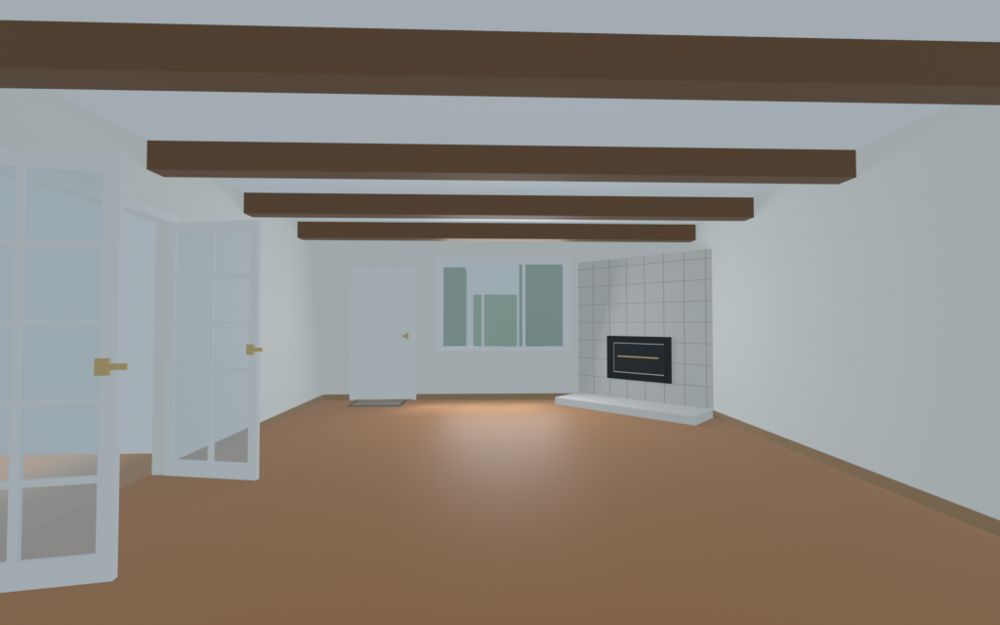

# Beamed Living Room with Fireplace

Suburban family living room, 18 ft wide (X) by 21 ft deep (Y) by 8.5 ft high (5.4864 × 6.4008 × 2.5908 m). Medium cherry floor, cream walls, wood baseboards, and a white ceiling with four separate dark wood beams running east-west. The north wall has a 36 × 80 in entry door and a three-section picture window. A pair of glass French doors (64 × 80 in, opened into the room) is on the west wall. A light-gray tile fireplace cuts across the northeast corner, with a raised hearth that extends onto the floor.

Inspired by a reference photo of an empty suburban living room: cherry laminate, cream walls with wood baseboards, four exposed dark beams, French doors on the left, a white entry door with a small rug, a three-section picture window on the far wall, and a tiled corner fireplace with a hearth that steps out onto the floor.

The interior floor center is the origin and the floor top is Z=0, so a furniture model whose origin is the bottom center of its footprint sits on the floor. Walls are 0.12 m thick outside that footprint. A furniture model's front faces local -Y, and each anchor's yaw is the Z rotation in degrees to apply when placing it.

The sofa faces the east wall, south of the hearth, so a family watches the TV with the fireplace ahead and to the right. `Sofa_spot` is yaw 90 and `TV_wall` is yaw -90. `Rug_center` and `Coffee_spot` sit between them. `Plant_corner` is the northwest corner by the entry, `Lamp_corner` is the southwest corner, and `Side_table` is the north end of the sofa. The raised hearth polygon in `metadata.json` is not free floor.

Ceiling, walls, and the four beams are separate objects so a viewer can hide them. The preview hides `Wall_S` (the wall behind the camera) and keeps the ceiling.

Rebuild from this folder:

```bash
blender -b --factory-startup --python build.py -- --outdir .
```


