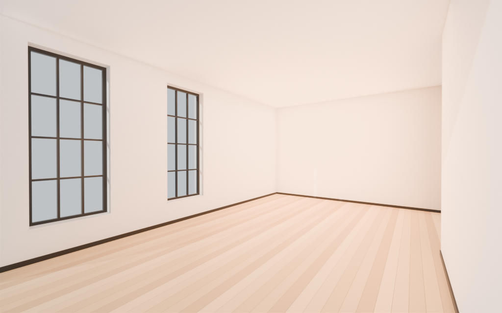

# Bright loft with tall windows

Empty loft shell, 5.79 m wide (X) by 7.62 m deep (Y) by 3.20 m high, 19 by 25 ft with a 10.5 ft ceiling. The interior floor center is the origin and the floor top is Z=0, so a furniture model whose origin is the bottom center of its footprint sits on the floor. Walls stand just outside that footprint (0.12 m, 0.34 m on the window wall so the frames sit in a reveal).

The west long wall has two tall black grid windows (3 by 4 panes) in deep white reveals. The east wall jogs into the room along its south run and leaves a 4 by 10 ft alcove in the northeast. A 36 by 80 in door is on the south wall, behind the preview camera. The floor is honey oak strips. Baseboards are thin and black. Ceiling is its own object so a viewer can hide it.

Inspired by the reference photo of a large empty loft: honey oak parquet strips, white walls, thin black baseboards, a high flat ceiling, two tall narrow black-framed windows on the left, and a wall jog on the right.



Furniture anchors (yaw is the Z rotation that points a model's local -Y front):

| Anchor | Position (m) | Yaw |
| --- | --- | --- |
| Sofa_spot | -0.67, -0.70, 0 | 180° toward the north TV wall |
| TV_wall | -0.67, 3.53, 0 | 0° |
| Rug_center | -0.67, 0.10, 0 | 0° |
| Coffee_spot | -0.67, 0.85, 0 | 0° |
| Plant_corner | -2.28, 3.19, 0 | 0° |
| Lamp_corner | -2.35, -3.23, 0 | 0° |
| Alcove_spot | 2.29, 2.29, 0 | -90° into the main room |

Walkable floor is the main bay plus the northeast alcove. The jog wall itself is not floor. See `free_floor` in `metadata.json`.

## Rebuild

From this folder, with [Blender 4.2 LTS](https://www.blender.org/download/lts/4-2/):

```bash
blender -b --factory-startup --python build.py -- --outdir .
```

The script uses only bpy, bmesh, and mathutils. It writes `model.glb`, `model.blend`, `preview.png`, and `metadata.json`.
