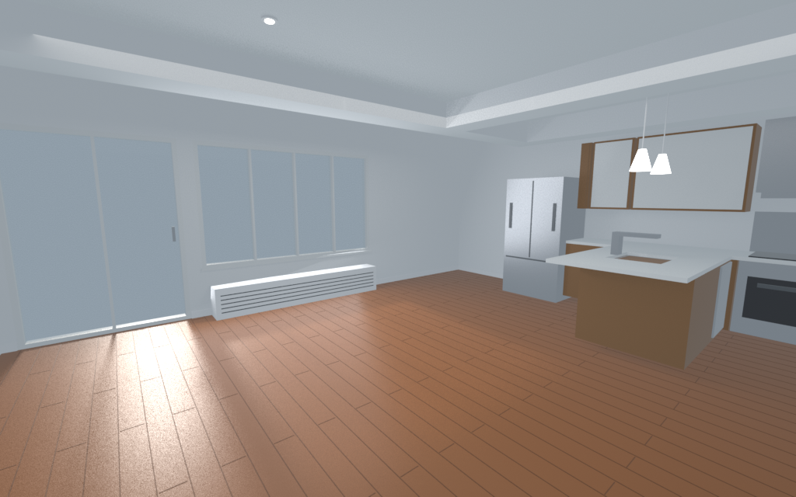

# Modern Condo Open Kitchen

Open-plan condo living room, 6.71 m wide (X) by 5.49 m deep (Y) by 2.74 m high, about 22 by 18 ft with a 9 ft ceiling. The interior floor center is the origin and the floor top is Z=0. Walls are 0.12 m thick outside that footprint.

Cherry plank floor and white walls. The kitchen sits in the southeast corner: walnut base cabinets, white-gloss and walnut uppers, a quartz peninsula with a sink, a stainless fridge and range, and two white pendants. A tray ceiling and dropped beam cover the kitchen. Wall_N has a sliding glass balcony door and a window with a radiator underneath. Wall_S has a 36 by 80 in entry door. The west side of the room is open for seating.

Inspired by two photos of the same NYC condo. One looks across the cherry floor toward the peninsula, pendants, tray ceiling, and balcony glazing. The other shows the open living area, the dropped soffit, the stainless fridge, and a doorway beside the kitchen.

Furniture front faces local -Y. Anchor yaw is `rotation_z_deg` in `metadata.json` (also stored on the empties). Sofa_spot is -90° so the sofa faces the west TV wall. Rug_center is 90° so the long side runs east-west.



Rebuild from this folder:

```bash
blender -b --factory-startup --python build.py -- --outdir .
```
