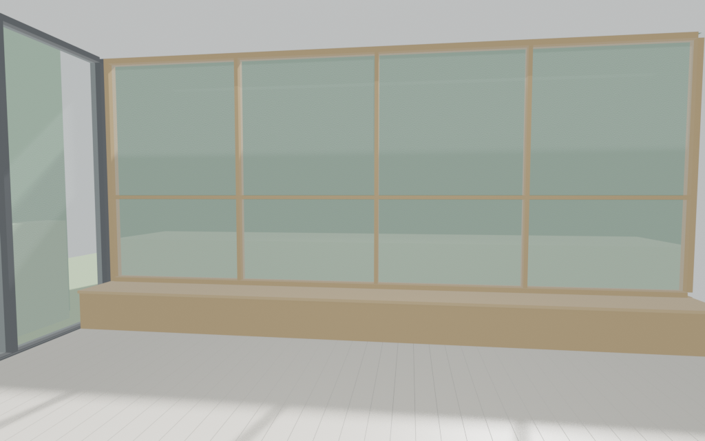

# Glass Wall Garden Room

Bright modern living room, 6.10 m wide (X) by 4.88 m deep (Y) by 2.90 m high, about 20 by 16 ft with a 9.5 ft ceiling. The long north wall is floor-to-ceiling glass with thin wood mullions (four bays, two rows) and a low wood bench along its base. Dark-framed sliding glass doors fill the west wall from the northwest corner. The east and south walls are solid white. A 36 by 80 in entry door is on the south wall. The floor is gray-washed wood planks and the ceiling is flat white. A simple green ground plane and hedge sit outside the glass.

Inspired by a modern room whose far wall is a wood-mullioned garden window with a built-in bench, and by a minimal room with dark-framed floor-to-ceiling sliding doors at the corner of a white wall.

The interior floor center is the origin and the floor top is Z=0, so a furniture model sits on the floor. Furniture front faces local -Y. `Sofa_spot` uses yaw 180° so the sofa faces the garden window. `TV_wall` uses yaw -90° so a screen on the east wall faces into the room. Other anchors: `Rug_center`, `Coffee_spot`, `Plant_corner`, `Lamp_corner`, `Side_table`.

Rebuild from this folder:

```bash
blender -b --factory-startup --python build.py -- --outdir .
```


