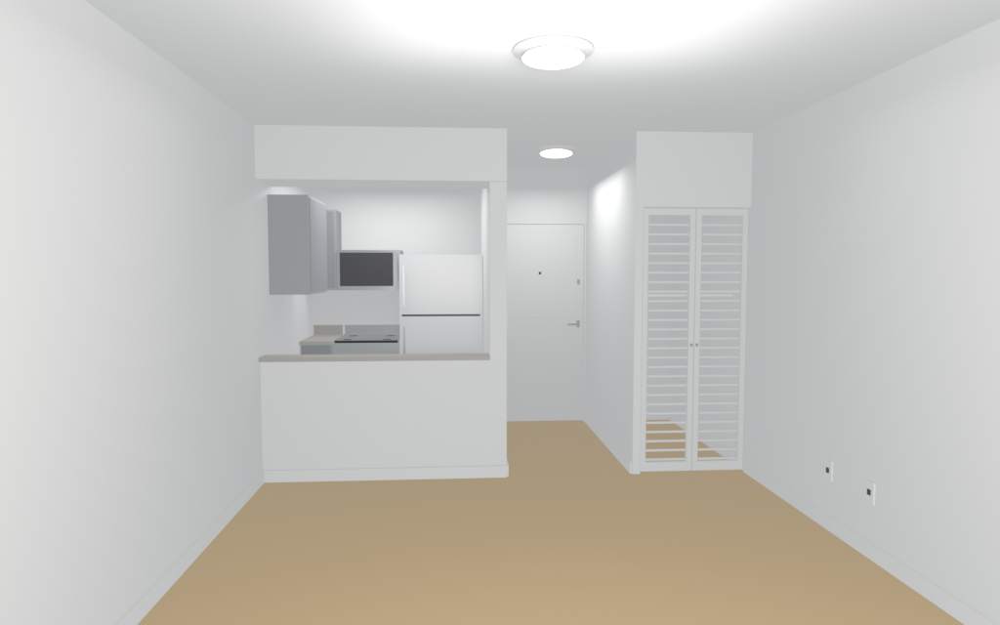

# Studio with Pass-Through Kitchen

Long narrow rental studio. The open living floor is 12 ft wide by 18.5 ft deep, under an 8.5 ft ceiling. A pass-through kitchen and a short entry hall sit at the far end (another 6 ft), so the full interior is 12 by 24.5 ft. Light oak floor, white walls and baseboards, flat white ceiling with flush dome lights.

Inspired by a listing photo of an empty studio: wide light-oak planks running the length of the room, a half-wall kitchen pass-through with a granite ledge (gray cabinets, white fridge, stainless microwave and range behind it), then a short hall to a white entry door and a closet with white louvered bifold doors. The near end, out of frame in that photo, is a window wall.

The interior floor center is the origin and the floor top is Z=0. Walls are 0.12 m thick outside that footprint. A furniture model's front faces local -Y, so anchor yaw is the Z rotation that points it the right way. Sofa_spot yaw is 90° (faces the east TV wall). TV_wall yaw is 270° (screen faces into the room).

Rebuild from this folder:

```bash
blender -b --factory-startup --python build.py -- --outdir .
```


